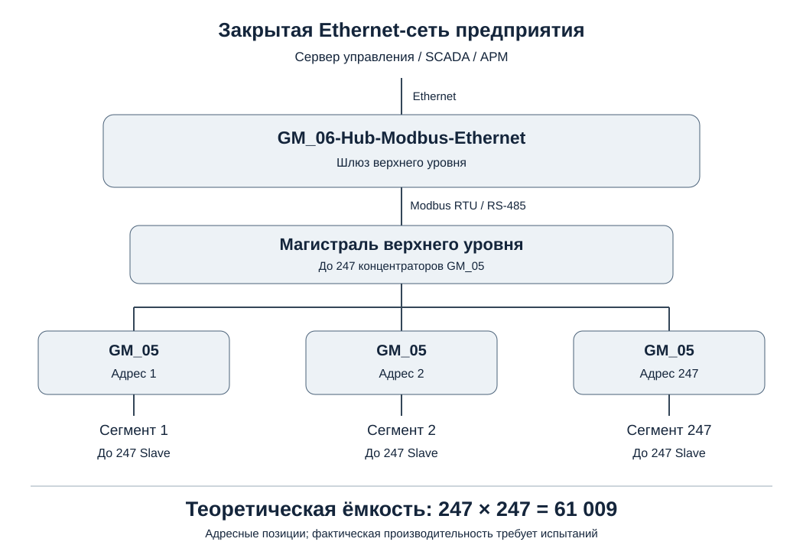

# Описание архитектуры

> Статус: рабочий проект; неутверждённые технические решения отмечены отдельно.
> Регламент: [rules.txt](../../rules.txt); корпоративный стиль: [WAS.txt](../../WAS.txt), [WAS.pdf](../../WAS.pdf).
> Дата: 2026-11-12.

## 1. Общая структура построения сети

Система представляет собой иерархическую сеть Modbus RTU по RS-485 с выходом через **GM_06-Hub-Modbus-Ethernet** в закрытую Ethernet-сеть предприятия.

На магистрали верхнего уровня могут располагаться до **247 концентраторов GM_05-Hub-Modbus-Modbus** с уникальными индивидуальными адресами. Каждый концентратор обслуживает отдельный нижестоящий сегмент RS-485, в котором могут быть адресованы до 247 конечных Slave, включая устройства **GM_02-Converter-Modbus-TKA**, **GM_03-Project-Lamp**, **GM_04-Project-Observer** и будущие совместимые устройства.

Теоретическая адресная ёмкость двухуровневой структуры: **247 × 247 = 61 009 конечных устройств**. Это архитектурная оценка, а не проверенная пропускная способность или гарантия физического подключения.

## 2. Составной адрес

Идентификатор конечного устройства состоит из **(адрес концентратора GM_05, адрес конечного Slave в сегменте)**. Стандартный кадр Modbus RTU имеет однобайтовое поле адреса и сам по себе не передаёт такую пару; протокол доставки составного адреса от GM_06 к GM_05 необходимо определить.

## 3. Групповые обращения

GM_05 должен уметь принять единую команду, адресованную нескольким конечным устройствам его сегмента, с общей полезной нагрузкой. Принят принцип последовательной адресной ретрансляции стандартных кадров; формат команд и обработка ответов пока не утверждены.

## 4. Ethernet

GM_06 обеспечивает соединение с закрытой локальной сетью предприятия. Формат прикладного обмена по Ethernet находится на рассмотрении в ТЗ.

## 5. Скорости обмена

Для каждого физического сегмента RS-485 может устанавливаться собственная скорость из утверждённого перечня. Участники одного сегмента используют согласованные параметры связи.

## 6. Масштабирование и ограничения

Требуется отдельно рассчитать время опроса, загрузку магистрали, задержки доставки групповых сообщений и электрическую нагрузку линий. Количество адресов Modbus (1–247) и электрически допустимое число приёмопередатчиков — разные ограничения.

## 7. Двухэтапная адресная рассылка GM_05 (уточнение)

GM_05 служит посредником между магистралью и собственным сегментом RS-485. Предусматривается последовательность:

1. Управляющий узел передаёт **подготовительную команду** для одного GM_05: перечень адресов (например, 5, 7, 12, 15) либо интервал (например, 10–25), режим исполнения и срок действия команды.
2. GM_05 подтверждает готовность принять ровно **один следующий шаблонный запрос**.
3. Управляющий узел передаёт следующий запрос GM_05; принятый шаблон Modbus RTU сохраняется в буфере.
4. GM_05 автономно отправляет по нижестоящему сегменту отдельную копию запроса каждому выбранному Slave, **заменяя только адрес конечного устройства и пересчитывая CRC**, если остальные поля подходят для адресного исполнения.
5. Ответы получателей, исключения, тайм-ауты и результаты доставки GM_05 собирает по согласуемым правилам для последующего чтения верхним уровнем.

За один момент на каждом сегменте допускается только один инициатор запросов (без коллизий Master). Обработка повторной подготовки, переполнения списка, рестарта GM_05 между двумя командами и привязка шаблона к инициатору пока не определены. Ведомым GM_02/03/04 достаточно обычной поддержки адресных функций Modbus RTU.

**Действительная экономия достигается на верхней магистрали; на нижнем уровне отправляется N адресных кадров.** Это уточнение заменяет прежнее представление об «одной групповой посылке по нижнему сегменту», ранее обозначенное как неутверждённый вариант.
