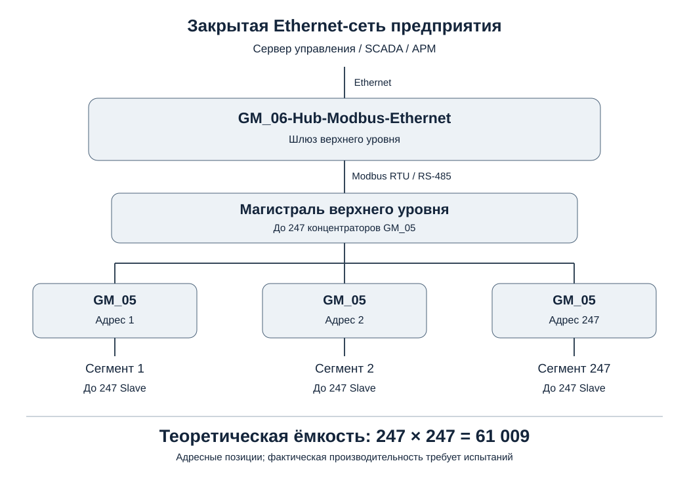

# Общая системная документация GM

**Статус:** предварительная редакция v0.1, 2026-11-12. Технические варианты без утверждения остаются открытыми и перечислены в ТЗ.

## Комплект документов

1. [Техническое задание](01-Technical-Requirements.md)
2. [Описание архитектуры](02-System-Architecture.md)
3. [Аппаратная часть](03-Hardware.md)
4. [Программное обеспечение](04-Software.md)
5. [Протоколы обмена](05-Protocols.md)
6. [Методика испытаний](06-Test-Procedure.md)
7. [История изменений](07-Change-History.md)

## Схема сети

## Нормативы оформления

- [Регламент работы](../../rules.txt)
- [Требования к корпоративному оформлению](../../WAS.txt)
- [Корпоративный брендбук](../../WAS.pdf)

> Внимание: SVG-схема — предварительная редакционная перерисовка топологии, а не копия фирменной графики WAS.pdf. Цветовую палитру и логотип нужно сверить с оригиналом брендбука перед выпуском оформленной версии.
