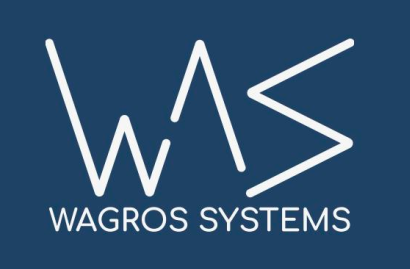

# Методика испытаний

> Проект: **GM_02-Converter-Modbus-TKA** · Редакция документа: **0.1 (рабочая, НЕ УТВЕРЖДЕНА)** · Дата: **2026-11-13**  
> Общие правила: [rules.txt](../../rules.txt) · Системные требования: [GM_01 / ТЗ](../GM_01-Project-General/01-Technical-Requirements.md) · Источник TKA: [спецификация v1.14 в GM_02](https://github.com/dmnazarenko-creator/GM_02-Converter-Modbus-TKA/blob/main/doc/TKA_SPD%20user%20%D1%81%D0%BF%D0%B5%D1%86%D0%B8%D1%84%D0%B8%D0%BA%D0%B0%D1%86%D0%B8%D1%8F_v1.14.pdf)  
> **Ограничение исходной проверки:** PDF найден (521 472 байта), однако его текст и рисунки пока не извлечены. Требования TKA ниже являются перечнем подлежащих уточнению пунктов, а не пересказом PDF.

## 1. Статус

План испытаний, не финальная методика; входные векторы TKA и количественные критерии ещё не получены.

## 2. Проверки

| ID | Проверка | Ожидаемое поведение | Статус |
| --- | --- | --- | --- |
| T-01 | Modbus RTU: верный/ошибочный CRC | Корректный приём / отбрасывание с диагностикой | Запланировано |
| T-02 | Modbus RTU: чужой адрес | Нет адресного ответа и LED2 не мигает | Запланировано |
| T-03 | Все общесистемные скорости | Обмен без потери допустимых кадров в согласованных условиях | Условия уточнить |
| T-04 | Тесты TKA из PDF v1.14 | Точное совпадение с официальными примерами | **Нет векторов** |
| T-05 | Трансляция Modbus ↔ TKA | Согласованная таблица соответствий без побочных команд | Нет карты |
| T-06 | Тайм-аут/обрыв/битый кадр TKA | Безопасный отказ, диагностируемая ошибка | Подробности уточнить |
| T-07 | Сохранение и сброс настроек | После перезапуска настройки сохраняются; кнопка >15 с восстанавливает 9600 | Не выполнено |
| T-08 | Прерывание обновления прошивки | Загрузчик остаётся доступен; непроверенный образ не запускается | Нужна Flash-архитектура |
| T-09 | Host-тесты и сборка CH32V203 | Успешные тесты независимого протокольного ядра | Код отсутствует |
| T-10 | Перенос на вторую CH32V | Протокольное ядро без аппаратно-зависимых правок | Вторая модель не выбрана |

## 3. Требования к стенду

Нужны: плата GM_02, тестовый Modbus master, устройство/эмулятор TKA, анализатор UART/RS-485, возможность контролируемого сброса и отключения питания. Состав оборудования пока не утверждён.
